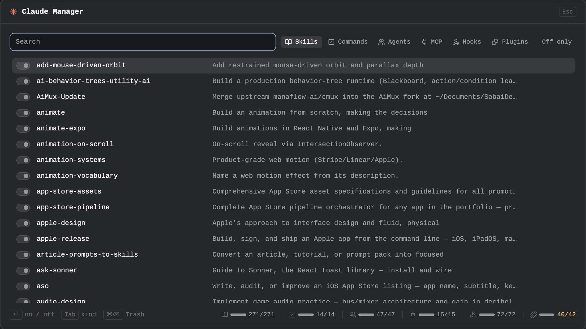

# Claude Manager

A dialog that lists everything Claude Code loads from `~/.claude` (skills, commands, agents, MCP servers, hooks and plugins) and turns each one on or off with a click. A switch is written into `~/.claude/settings.json` the way Claude Code itself does it, so turning an item back on leaves the file byte for byte as it was. A skill or an agent can also be moved to the Trash.

## What you see

A centered 16:9 dialog (`kind: "dialog"`, 1040×585, `popover` background, 13px text), in the quiet style of a status bar: grey by default, one coral mark, and color only where it means something.

- **Header** (42px, hairline under it): a 14px Claude asterisk glyph in coral `#D97757`, `Claude Manager` (semibold), and an `Esc` keycap on the right.
- **Body:** 16px padding, 12px gaps.
  - **Top row:** a search field (32px, `Search`) that takes the free width and has focus on open. Then six chips (22px, 6px radius), each a 12px line icon plus a label: `Skills`, `Commands`, `Agents`, `MCP`, `Hooks`, `Plugins`. The active chip sits on `selected` with its icon in `foreground`, the others are `muted`. Last, an `Off only` chip.
  - **Status line** (only when there is something to say): `dim` while loading, `blocked` for a failure, `working` (amber) for a pending Trash confirmation.
  - **List:** a virtual list 1008px wide, 28px rows (8px radius, 8px padding, 12px gap) with a scrollbar overlaid.
    - **Switch:** 24×14, 7px radius, an 8px knob. On: knob right in `muted`, track `border`. Off: knob left in `dim`, hollow track with an `input` hairline. A row waiting for its write is at 50% opacity.
    - **Name:** 300px, truncated, `foreground` (`dim` when off), medium weight when selected.
    - **Description:** 12px, `muted` (`dim` when off), truncated.
    - **State tag:** 80px, right-aligned, 10.5px. `off` in `working` (amber), or a partial `skillOverrides` mode (`name-only`, `user-invocable-only`) in `dim`.
    - **Hooks tab:** an extra 136px `muted` column with the event (`PreToolUse`, `Stop`…), shown only on the first row of each event, so the list reads as groups. The name column narrows to 220px. The first row, `All hooks`, is the master switch, with its name in medium weight.
    - The selected row sits on `selected`.
  - **Footer strip:**
    - **Left:** keycap hints: `↵ on / off`, `Tab kind`, and `⌘⌫ Trash` on the Skills and Agents tabs only.
    - **Right:** one gauge per kind, separated by 1×14 hairlines, as in a quota bar. Each gauge is the kind's 12px icon in `dim`, a 28×4 bar (`muted` fill on `border`) showing the share that is on, and `on/total` (11px). The count is `muted`, or `working` (amber) when something in that kind is off. The tooltip says `Skills: 269 of 271 load in new sessions`.
- **Icons:** six lucide glyphs (24 viewBox, stroke 2, `currentColor`): book-open (skills), square-slash (commands), users (agents), plug (MCP), webhook (hooks) and puzzle (plugins).

## How it behaves

- **Opening:** ⌘⇧K runs `mod.open:claude-manager`, and pressing it again closes the dialog. On open it runs `manage.py list` and draws the result.
- **Search** matches the name, the description and, for hooks, the event.
- **Moving:** ↑/↓ move by one, PgUp/PgDn by ten. Tab and ⇧Tab cycle the six kinds, and a click on a chip picks one. `Off only` hides what is on.
- **Flipping:** Enter or a click on a row flips its switch.
  - The row changes at once (optimistic), shows busy, runs `manage.py set KIND ID on|off`, then reloads the list from the files. What is drawn is always what the files say.
  - Writes run one at a time, because each is a read-modify-write of `settings.json`. Two quick clicks on two rows both land, in order.
- **Moving to the Trash (Skills and Agents only):**
  - The first ⌘⌫ only names what will go (`⌘⌫ again moves animate to the Trash, its whole folder`). Any other key or click cancels.
  - The second runs `manage.py delete`. The status then says `animate is in the Trash`, and Finder's Put Back undoes it.
- **Effect:** changes apply to new Claude Code sessions. A running session keeps what it loaded, except agent denials, which reach it live.
- **Errors:** an error from `manage.py` shows on the status line in `blocked`. The list is then reloaded from the files, so a failed write never stays drawn as done.

## Built from

- `mods/claude-manager/mod.json`: `{"place":"none","title":"Claude Manager","overlay":{"kind":"dialog","width":1040,"height":585}}`. `keys.json`: `"cmd-shift-k": "mod.open:claude-manager"` in `global`.
- **`main.js`:**
  - **Libraries:** `View`, `div` and `svg` from gpui-kit; `v_flex`, `h_flex`, `InputState`, `Input`, `v_virtual_list`, `VirtualListScrollHandle` and `Scrollbar` from gpui-base.
  - **herdr functions:** `theme`, `exec`, `appHome`, `props` and `closeOverlay`.
  - **Kit:** `header`, `field`, `kbd`, `kbdHint`, `chip`, `SIZE` and `CORAL` come from the shared Crew `kit.js`.
- **`manage.py`:** stdlib Python 3, run with `python3 -I`.
  - **`list`** prints `{skills, commands, agents, mcp, hooks, plugins}`, each a list of `{id, name, desc, on}`. Hooks also carry `event`.
  - **`set KIND ID on|off`** writes the switch. Each kind uses its own mechanism:

    | Kind | Read from | Off writes | On |
    |---|---|---|---|
    | skill | `~/.claude/skills/*/SKILL.md` | `"skillOverrides": {ID: "off"}` | key removed |
    | command | `~/.claude/commands/*.md` | `"skillOverrides": {ID: "off"}` (commands share it) | key removed |
    | agent | `~/.claude/agents/**/*.md` (frontmatter `name`) | `"permissions.deny": ["Agent(ID)"]` | rule removed (`Task(ID)` too) |
    | mcp | `~/.claude.json` → `mcpServers` | `"deniedMcpServers": [{"serverName": ID}]` (every scope) | entry removed |
    | plugin | `settings.json` → `enabledPlugins` (description from `<installPath>/.claude-plugin/plugin.json`) | `false` | `true` |
    | hook `*` | — | `"disableAllHooks": true` (every hook and the status line) | key removed |
    | one hook | `settings.json` → `hooks` | taken out of `settings.json`, kept with its event, group and positions in `~/.claude/claude-manager/hooks-off.json` | put back in the same place |

  - **Every write** is atomic: a temp file in the same folder, `fsync`, then `os.replace`, keeping the file's mode. The previous file is first copied to `<file>.bak-claude-manager`. JSON is written with `indent=2, ensure_ascii=False` plus a final newline, which is how Claude Code writes `settings.json`, so an unchanged file round-trips byte for byte.
  - **`delete skill|agent ID`** runs macOS `/usr/bin/trash`, so Put Back works.
    - A skill goes whole: its folder, and when it is a symlink, the folder the link points to as well.
    - An agent goes as its `.md` file.
    - Its switch is cleared from `settings.json` too.
  - **Hook labels:** the script's basename plus its first argument (`graft-hooks post-edit`), or the first two words of the command (`tuios agent-hook`), dropping flags. An owner folder like `~/.orca/` becomes a prefix (`orca claude-hook`).
  - **Hook descriptions:** the matcher, then the command with the home folder written as `~`. A long inline shell script reads `inline shell script`.
  - **Hook ids:** the first 12 hex digits of the SHA-1 of `[event, group without hooks, hook]`.
- **Tests:** `tests/test_manage.py` builds a fake `HOME` and `CLAUDE_CONFIG_DIR`, then switches every kind off and on and checks the file comes back byte for byte. It also covers hooks put back in a different order from how they went off, including an emptied group and event, and delete on a linked skill with `subprocess.run` patched.

## Watch out

- **Never use a handler's `cx` after an `await`.** A click's `cx` is dead once the handler returns.
  - Calling its `notify()` later throws. If that happens inside a promise chain, the chain stays rejected and every later write is silently skipped: the first click works, then nothing does.
  - Run each write in its own `cx.spawn(async (cx) => …)`, behind a lock that is always released in `finally`.
- **Rows of a `v_virtual_list` can't hold handlers.** Use `on_item_click` with a unique key. Key on `id`, not `name`: hook labels repeat across events.
- **Check what each mechanism really does.** In Claude Code 2.1.319, `skillOverrides` hides a skill or command from the model, `deniedMcpServers` keeps a server from loading, and a denied agent disappears from the Agent tool's list. A denied agent still shows in the `system/init` agents list, so check agents by asking the model, not by reading init.
- **Plugin skills are not affected by `skillOverrides`.** Turn the plugin off instead.
- **Never use `claude mcp remove` to switch a server off.** It deletes the server's config and wipes its OAuth tokens.
- **Never print MCP `env`, `headers` or `args`.** They hold tokens. Only the transport and the command's basename or the URL's host are shown.
- **`disableAllHooks` also turns off the status line.** The master row says so.
- **Turning a skill off loses a partial mode.** A skill set to `name-only` or `user-invocable-only` comes back as plain on.
- **Trashing a symlinked skill removes the real folder.** If other tools read that folder (`~/.agents/skills`, for example), they lose the skill too. A link that resolves outside `$HOME`, or to a folder with another name, is refused.
- **Writing `settings.json` can race with Claude Code.** Claude Code writes it too. The file is read right before each write, which keeps the race window small.

## Done when

- `herdr-app check ~/.config/herdr-app/mods/claude-manager` passes, and `python3 -I tests/test_manage.py` prints `ok` and `delete ok`.
- ⌘⇧K opens the dialog with your real counts in all six chips and gauges.
- **Every tab, by mouse:** a click on a row turns it off: the row dims, `off` appears in amber, the gauge count turns amber, and `settings.json` gains the matching entry. A second click turns it back on and `cmp` with a copy taken before shows no difference.
- After turning a skill off, a fresh `claude -p … --output-format stream-json --verbose` no longer lists it in `system/init` `skills`. An MCP server disappears from `mcp_servers`, and a plugin from `plugins`.
- Two quick clicks on two different rows both land.
- ⌘⌫ twice on a throwaway skill puts its folder in the Finder Trash, and Put Back restores it.
