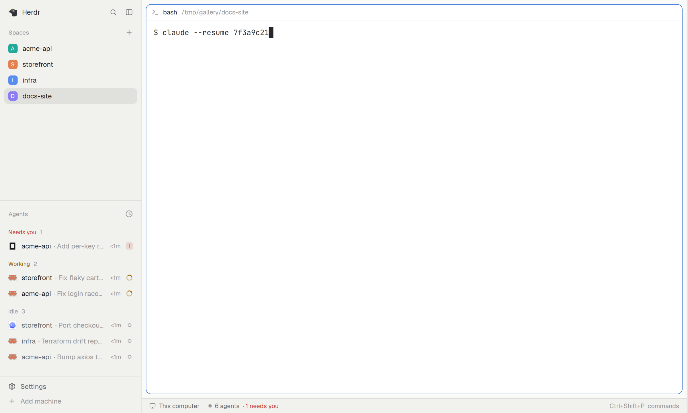

# Idle reaper

Agents that clean up after themselves. An agent idle for hours is parked: it exits and its resume command is typed at
the shell prompt, not run. One keypress brings the session back. A parked pane nobody came back to for days is closed.

## What you see

The mod draws nothing. What you see is its result: a pane that was an agent now shows a plain shell prompt with the
resume command already typed after it (`$ claude --resume 7f3a9c21`, cursor at the end, Enter not pressed). Give the
mod a real layout block instead of a zero-size one to see its last log lines.

## How it behaves

- Every `interval_s` (600, 60 at least) it looks at all terminals.
- **Park:** an agent idle for `park_after_s` (14400 = 4 h) is sent `/exit`, then its resume command is typed with
  `hc keys` without Enter. The pane's shell stays.
- **Close:** a parked pane untouched for `close_after_s` (259200 = 3 days, counted from when it went idle) is closed, but
  only if its screen still shows the typed command; if you touched it, the reaper forgets it.
- Never touched: a focused terminal, an agent that is working or blocked, a terminal you named, a pane whose shell sits
  in another folder than the agent, a terminal that runs the agent with no shell underneath.
- `dry_run: true` logs what it would do and changes nothing.
- `groups` bound sessions that should be closed rather than parked (`close_after_s`, `max_live`, `min_idle_s`,
  `exempt`). `apps` says how to resume each program; Claude Code and OpenCode are built in.

## Built from

- `mods/idle-reaper/` with `mod.json` `{ "place": "none", "title": "Idle reaper" }` and a zero-size layout block
  `{ "id": "idle-reaper", "type": "block", "size": { "px": 0 }, "content": { "mod": "idle-reaper" } }`.
- `reaper.js` (the whole policy, pure and tested: `plan`, `appFor`, `resumeCommand`, `typable`), `runner.js` (the `hc`
  and `/proc` or `lsof` glue; `run`, `makeCwdOf`), `config.js` and `lease.js` (copied from `shared/`), `main.js`.
- It runs `hc ls`, `hc send`, `hc keys`, `hc kill` and reads a shell's folder from `/proc/<pid>/cwd` (`lsof` on macOS).
  `scripts/idle-reaper` runs the same code from a timer when the window is closed (`contrib/` has systemd and launchd
  units); it does nothing while a window is open and shares one state file.

## Watch out

- `hc keys` cannot type `_ : & ~ (` or capitals, so a resume command that needs them (OpenCode's `ses_…` ids) is not
  parked; the agent is left alone.
- It is the one mod here that acts on terminals. Read `reaper.js` first; try `dry_run` before turning it on.
- The preview is a shell with a typed command, not a mod screen: a faithful build shows no UI of its own.

## Done when

1. `herdr-app check mods/idle-reaper` passes.
2. With `park_after_s` set to 60 and an idle Claude Code agent in a shell, a minute later the agent has exited and
   `claude --resume <id>` is typed at the prompt without having run.
3. With `dry_run: true` nothing changes and the log says what would have.
4. A working or focused agent is never parked.
