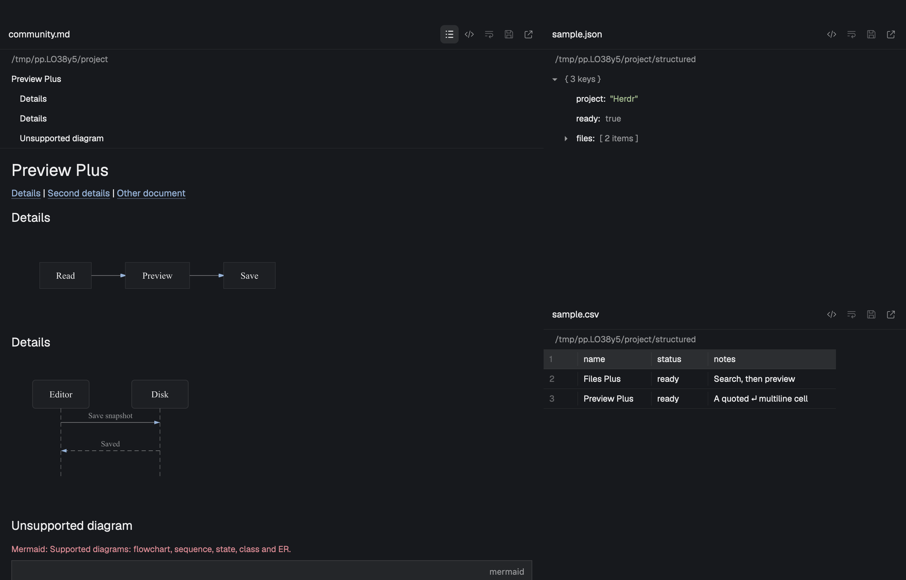

# Preview Plus

Edit local text and preview Markdown, JSON, CSV, TSV, images and PDFs in Herdr. Use Preview Plus as a Files panel, receive files from Files Plus, or open a file in a separate pane or tab. Save checks for external changes, drafts survive navigation, and local links have back history.



The unedited `herdr-app shot` shows Markdown contents, flowchart and sequence diagrams, unsupported-diagram feedback, a JSON tree and a CSV table in a disposable Herdr 0.1.13 window. All documents are test fixtures. Preserve the capture's sRGB metadata.

## What you see

In Files panel modes, the 42px header holds Back, the file name or "Files" (13px semibold, truncated), a Preview/Source toggle for Markdown, JSON, CSV and TSV, Wrap lines, Save, and Open. The mode toggle shows the next action: code for Source, eye for Preview. Wrap lines keeps its position in both modes, disabled in Preview and enabled in Source. Refresh replaces file actions in the tree. All these controls are icon buttons with tooltips and accessible names. Follow Herdr's Workspace Chrome: 26px targets, 14px tintable native SVGs, 6px corners, theme muted/foreground/hover/selected colors, and the default arrow pointer. The top separator is 0.5px. There is no extra editor toolbar. Pane and tab mode omit Back and the mod's rounded outer border, using the host pane frame instead. A 6px muted dot beside the filename indicates unsaved/saving state; its tooltip explains which. Read-only text has a lock icon. The discard action appears only for dirty files and becomes a confirmation check with an adjacent cancel cross. A 28px path row below the header displays the containing directory or workspace cwd in 12px muted text.

An image or PDF adds a wrapping toolbar (minimum 36px high with a 1px bottom separator) holding Fit, −, an editable percentage and + zoom controls. The percentage frame is 76px wide and 28px high, with a 0.5px border and centered 12px Geist Mono text. PDFs additionally display Previous, the current and total page count (`page / total`), and Next. Drag enlarged media with the left mouse button to pan in both directions; the pointer changes from grab to grabbing. Releasing or leaving the canvas stops the drag. Fit resets panning, centers the media and sizes it to the current viewport with 16px padding while preserving the aspect ratio.

Markdown documents render formatted text interleaved with native image blocks sized to document width and aspect ratio. An inline warning banner in 12px muted text indicates unresolvable or remote inline images. Source mode and plain text files render in the native syntax-highlighted editor using Herdr's configured code font and size, with zoom applied once. Complete local text is editable; remote and truncated text stays read-only. The standalone Files tree has 28px file rows, 18px indentation per level, folder and file icons, and Git status letters at the right edge.

Follow Git Graph's Herdr integration: read colors directly from `theme()` and UI/code font families from resolved `settings()`. Preserve color alpha, custom color overrides and same-appearance theme changes. Unexposed fields use the actual Herdr 0.1.11 Files/Changes defaults: a 1px theme-colored border, 10px panel corners, a semibold title, 13px interface text, 12px secondary text and 1px separators. Rows use 7px corners, 18px indentation and 6px tree padding. There is no separate Preview Plus palette or type/spacing/radius scale. The generic `cx.theme()` scale is not Herdr's shipped panel styling. Native editor and rich-text internals retain Herdr's theme. UI and code sizes receive zoom exactly once; version upgrades require rechecking unexposed control defaults.

Buttons retain the default arrow pointer. Hover changes only the control's own background and text color; selected modes retain their selection background, and pressed controls use the theme selection surface. Toolbar buttons have 6px corners. Disabled controls use `theme().dim`, have no hover/click action, and remain on the default pointer. Symbol controls have accessible names/tooltips. Media controls are disabled while unavailable, zoom steps disable at 5%/800%, PDF navigation disables at page bounds or while loading, and Refresh disables during a tree refresh. Button presses stop propagation to their container.

## How it behaves

The rich Preview/Source toggle also applies to JSON, CSV and TSV. Markdown adds a Contents icon when it has headings. It opens a list above the document with 28px virtual rows, 12px text, 12px indentation per heading level and at most 180px height. Selecting a heading starts the document at that section, with a 28px Whole document action above it. JSON and delimited data use 28px virtual rows, 12px text, theme colors and 0.5px separators. JSON containers have disclosure glyphs; table row numbers occupy 48px, columns measure 80–320px and scroll horizontally. The first record is emphasized without discarding it or assuming a header. No editable cells or additional table toolbar are added.

### Three operating modes

- **Standalone Files panel mode** (with no `file` or `previewStack` prop): displays the focused terminal's single-folder tree. Loads folders lazily; sorts directories first, includes hidden entries, omits `.git` and avoids recursing through symlink directories. Retains expansion state while a file replaces the tree. Clicking Back (`←`) walks link history first, then returns to that tree. Remote trees refresh on a 10-second timer and offer manual Refresh.
- **Paired with Files Plus** (`props.previewStack` set): receives file targets from Files Plus via `shared("preview-plus.target")[spaceId]`. At the root of history, clicking Back runs `run("layout.select", { stack: props().previewStack, child: "files-plus-tree" })` to return to Files Plus. Leaves the source tree and other shared state alone.
- **Standalone mod pane or tab** (`props.file` passed via `pane.split` or `tab.new`): shows that absolute path directly, defaulting `root` to its directory and `on` to local. The header has no Back button or additional rounded outer frame; the `preview-plus.back` command can still walk followed-link history.

### Markdown preview and source editing

Render `.md` and `.markdown` through native `TextView.markdown()`; Source uses a retained `Editor`. Plain text uses the same editor. Complete local UTF-8 text is editable. Track the draft separately from the last saved snapshot using native change events. Save through `writeTextFile(file, text, expected)`; save the submitted snapshot, and keep later typing dirty if a save finishes while the person is still editing. Reject duplicate in-flight saves. `Cmd+S` on macOS and `Ctrl+S` elsewhere operate on the focused mod's document without changing global bindings. Native selection, clipboard and undo/redo remain editor-owned.

Keep unsaved drafts across navigation and persist only dirty/in-flight documents in this mod's `localStorage`. Restore them when reopening the file, including after the file is removed or externally changed. A completed save or confirmed discard removes its recovery entry. Flush pending storage writes on normal close. Show storage and save failures without dropping the in-memory text. Conflict recovery is explicit: keep/copy the draft, or confirm discard to reload disk; never silently force-overwrite an external edit.

Preview renders the current draft, including local image references, without saving. Wrap lines toggles `soft_wrap` and remembers the setting; it never inserts newline characters. This host exposes no dynamic Editor wrap/style setter, so rebuild from the draft when wrap or code appearance changes. Selection, scroll and undo history can reset on those rebuilds. Truncate text after 400,000 characters with a visible notice and no Save action. Show explicit missing, unreadable and binary-file states when no recoverable draft exists.

### Interleaved inline Markdown images

Render local Markdown image references as native image blocks interleaved with text blocks inside the same scroll region. Support inline and reference image syntax, angle-delimited destinations, escaped parentheses, optional titles and linked images. Preserve fenced and inline code blocks without rewriting code examples. Reuse reference definitions in each text block so links still resolve across image boundaries. Clicking an image opens it in Preview Plus or follows its enclosing link. Images preserve their aspect ratio and fit the document width. HTML `` syntax and precise inline-image/list/table composition are not implemented.

### Relative link navigation and in-memory history stack

Resolve local Markdown links against the current file's directory, including `..`, encoded names, and paths with spaces. Carry the owning root and machine through navigation. Save each previous target's source mode, page, zoom, heading, contents visibility and JSON expansion in memory. Back restores that state and the existing draft. HTTP(S) links call `cx.open_url` without adding history. Fragment-only links and cross-document fragments select headings; invalid/missing fragments show a visible message without discarding source. Same-document navigation retains the editor object and undo state.

### Contents and heading anchors

Extract top-level ATX and single-line setext headings while respecting all backtick/tilde fences and indented code. Strip common inline emphasis/link markup from labels, lowercase letters, keep Unicode letters/numbers, underscores and hyphens, remove punctuation, and replace whitespace with hyphens. Deduplicate slugs with numeric suffixes while avoiding collisions with literal suffixed headings. HTML/custom ids and headings nested in list/blockquote containers are outside this subset.

The installed host exposes programmatic scrolling only for virtual lists, whose deferred rows cannot register Markdown link callbacks. Keep native link handlers by showing blocks from the selected heading onward in an ordinary scroll area with a distinct identity. Whole document restores earlier sections; Back also retraces same-document anchors. Parse headings from the current draft, not a separate disk read.

### Native Mermaid diagrams

Render top-level `mermaid` fences through beautiful-mermaid 1.1.3, bundled at build time with elkjs and entities. Supported families are `graph`/`flowchart`, `sequenceDiagram`, `stateDiagram`/`stateDiagram-v2`, `classDiagram` and `erDiagram`, within that library's syntax subset. Pie, gantt, mindmap, HTML labels and interactive diagram links are not supported. Ordinary/nested code fences stay source. Malformed, unsupported, oversized or unclosed diagrams show their original fenced source and an error.

Translate SVG CSS variables and color mixing into literal native colors, preserve alpha, remove remote font imports and use the configured UI font. Write SVGs under `mods/preview-plus/.cache/diagrams/` and draw them with native `image()`, horizontally scrolling wide diagrams at natural size. Cache by exact source/colors/font in memory (24 entries) and a versioned content/theme key on disk. Request ownership and staging tokens reject stale document/theme results. Limit each diagram to 24,000 characters/300 lines and 32,768px per dimension; at most 24 diagrams render per document. Disk cache eviction is manual. No runtime Node, Chromium, browser worker or network request is used.

### JSON and delimited previews

Recognize `.json`, `.csv` and `.tsv` case-insensitively. JSON uses `JSON.parse` after removing a leading BOM; primitives and empty containers are valid. The root starts expanded. Keep expanded containers by escaped JSON Pointer, flatten iteratively to bounded visible rows, and handle disclosure clicks at the native list level. Show at most 10,000 rows and 64 levels; cap displayed scalar text at 500 characters. Number parsing follows JavaScript semantics; Source retains the exact original spelling.

CSV selects comma or semicolon from the first record outside quoted fields; TSV always uses tab. Parse doubled quotes, quoted delimiters/newlines, LF/CRLF/CR and BOM. Preserve trailing empty cells, blank records and ragged rows. Reject unclosed/misplaced quotes and text after a closing quote. Retain at most 10,000 records and 100 columns with a visible limit notice. Sample the first 200 records for widths; show at most 500 characters per cell, displaying embedded newlines as a return symbol. Render only requested native virtual rows.

Preview never writes parsed values back to source. Its toggle uses the retained editor and existing draft/save/conflict/discard path unchanged. Invalid data keeps Source accessible and editable for complete local files. The 400,000-character truncation guard blocks parsing and Save; remote data is read-only. Display-only row/depth/column limits leave complete local source editable.

### Multi-format image inspection

Stage `.png`, `.jpg`, `.jpeg`, `.webp` and `.svg` under `mods/preview-plus/.cache/`. Derive the filename from source path, modification time and size. Keep source bytes unchanged. Fit is the default; its percentage follows the fitted display size divided by the source image dimensions. Percentages use logical window pixels per source pixel, independent of Herdr's app zoom (not physical Retina pixels). Enter a number with an optional percent suffix and press Enter or leave the field to apply it; invalid text restores the current percentage, and numeric values clamp to 5–800%. Enter 100 for actual size. The −/+ buttons step by 1.25×. Mouse wheel and trackpad vertical scrolling over the canvas zoom continuously from the current size. Hold Shift to pan instead. Panning is bounded by the enlarged image edges; smaller images stay centered. Herdr 0.1.11 exposes scroll events but no pinch/magnify event; trackpad pinch is not supported. The same controls apply to PDF rasters. Open launches the local system application (`open`, `explorer.exe`, or `xdg-open`). Disabled for remote files.

### macOS PDF viewing

On macOS, use PDFKit through JXA (`osascript -l JavaScript`) to inspect the page count and rasterize only the requested page, never the entire PDF into memory at once. Cache each page separately as PNG, limiting the raster's longest edge to 2,048 pixels and its scale to 2×; zoom enlarges that raster. Previous and Next controls turn pages with bounds checking. Clamp the page if an external edit reduces the page count. Reject locked, empty or unreadable PDFs with a visible error.

### File watching and reload

Watch the displayed local file and local images referenced by Markdown using `watchFolder`. Resolve parent-directory aliases to physical paths (`pwd -P`) when comparing native events to handle macOS `/private/tmp` vs `/tmp` paths. Reload clean modified, atomically replaced, deleted and restored files. Preserve dirty/in-flight buffers and report external changes instead. Unchanged source events, including the mod's own save, retain the editor and undo history. Refresh referenced Markdown images from the draft. Queue a reload if an update arrives during an active read or conversion. Ignore unrelated file events. Remote previews reload when reopened or sent `preview-plus.refresh`.

### Request identity and external commands

Apply async results only when the target request, file, machine and active space still match. Switching a target resets link history. Release retained editors when the target or view closes.

Optional external commands can be sent via `nextCommand()`: `back`, `source`, `preview`, `save`, `wrap`, `refresh`, `fit`, `zoom-in`, `zoom-out`, `next` and `previous`, delivered as `preview-plus.<command>`.

Agent working, blocked, done and idle displays remain the surrounding Herdr UI's responsibility.

## Built from

```text
preview-plus/
  RECIPE.md, README.md, preview.png, licenses/
  mods/preview-plus/
    main.js, tree.js, paths.js, markdown.js, markdown-structure.js, markdown-view.js,
    structured.js, structured-view.js, mermaid.js, mermaid.bundle.js,
    media.js, appearance.js, mod.json, icons/, licenses/, THIRD_PARTY.md
  build/, package.json, package-lock.json
  tests/
```

Default-export a class extending `View`. `main.js` owns mode selection, request identity, source state, history, watchers, page/zoom controls and rendering. `tree.js` owns lazy enumeration and Git marks. `paths.js` normalizes paths and resolves links. `markdown.js` extracts local image references without rewriting code examples. `media.js` stages images and renders a single PDF page through argument-separated external calls. `appearance.js` reads Herdr colors and configured fonts directly. Retained source editors update their font and syntax from cached text on a theme/font change without rereading the file.

Use GPUI `div`, `svg`, `image`, `v_flex`, `h_flex`, `TextView`, `EditorState` and `Editor`. Use `cx.spawn` for work, callback-owned contexts for updates, and `on_size_change` for viewport measurements. Herdr supplies `props`, `shared`, `spaces`, `panes`, `focused`, `settings`, `theme`, `window`, `appHome`, `exec`, `readTextFile`, `writeTextFile`, `watchFolder`, `nextCommand` and `run`. Use host `localStorage` for draft recovery and the wrap preference. The toolbar's original SVG assets follow Herdr's tintable outline style and are packaged with this mod. Only paired Back runs `layout.select`; it never writes the shared target.

The mod manifest is `{ "place": "none" }`. Supported layout setups include:

1. **Standalone Files panel**:
```json
{ "id": "files", "type": "block", "content": { "mod": "preview-plus" } }
```

2. **Paired with Files Plus**:
```json
{
  "id": "files", "type": "stack", "active": "files-plus-tree",
  "children": [
    { "id": "files-plus-tree", "type": "block", "content": { "mod": "files-plus", "props": { "previewStack": "files" } } },
    { "id": "preview-plus", "type": "block", "content": { "mod": "preview-plus", "props": { "previewStack": "files" } } }
  ]
}
```

3. **Standalone pane or tab**:
```sh
herdr-app do pane.split '{"direction":"right","mod":"preview-plus","props":{"file":"/absolute/path/README.md"}}'
herdr-app do tab.new '{"name":"Document","mod":"preview-plus","props":{"file":"/absolute/path/guide.pdf"}}'
```

Shared state contract when paired with Files Plus:
```ts
"preview-plus.target": Record<SpaceId, {
  file: string;
  root: string;
  on: string | null;
}>
```

Files Plus dispatches every file to this receiver without changing the target object; choose its Inside right panel setting for the paired stack. Complete local UTF-8 code, configuration, hidden files, unknown extensions and extensionless files use the native text editor. Rich preview formats remain unchanged. Older Files Plus versions may route ordinary text to their read-only source viewer; update both packages to use this contract.

`markdown-structure.js` owns heading/fence offsets, `markdown.js` stages images and diagrams, and `markdown-view.js` owns rich document/contents rendering. `structured.js` owns pure parsing and JSON rows; `structured-view.js` owns virtual rows with `uniform_list` and `Scrollbar`. `mermaid.js` owns bounded SVG conversion and content/theme caching, using Herdr's restricted `fs/promises.mkdir` to prepare its cache directory. The renderer loads lazily through a module import. Rebuild from public npm with `cd preview-plus && npm ci --ignore-scripts && npm run build`; `npm run build -- --check` compares the generated bytes. The install includes the bundle and its runtime license notices, not Node dependencies.

`on_size_change` reports window points, while builder dimensions receive Herdr's app zoom. Divide measured dimensions by `settings().zoom || 1` before computing fit sizes. Put Markdown images inside an interactive `div` so native clicks are reliably delivered.

### External programs and files

The mod reads selected files, referenced local images, displayed directories and Git metadata. It writes selected local text files only on Save, and stores media cache, draft recovery text and the wrap preference inside Herdr's app storage. Drafts include the original snapshot needed for conflict detection; both copies are removed after saving or confirmed discard. No service credentials are required. Preview Plus makes no HTTP requests itself; opening an HTTP(S) link uses the system browser.

macOS image staging uses `osascript -l JavaScript` with Foundation and AppKit. PDFs additionally use PDFKit. Linux/Windows image staging uses Python 3's standard library to read PNG/JPEG/WebP/SVG dimensions and copy bytes. Directory browsing uses `sh` on POSIX machines and PowerShell locally on Windows; Git marks use `git`, and physical-directory matching uses `pwd -P` on POSIX. Open uses `open`, `xdg-open` or `explorer.exe` for the local platform. Pass file paths as arguments; never splice them into executable JavaScript or shell code.

The cache contains copies of viewed files. It is local, disposable and excluded from Git. Close viewers before removing `.cache/`; it is recreated on demand. Cache eviction is manual.

### Attribution

Directory enumeration, bounded browsing and Git-status handling adapt the Files mod bundled with [Herdr 0.1.11](https://github.com/herdrdev/herdr-app); see [Apache-2.0](licenses/Herdr-APACHE-2.0.txt). The changes add the standalone preview tree, request ownership and local-file integration. Earlier releases used a Radix palette; its [MIT notice](licenses/Radix-MIT.txt) is retained. The current mod reads Herdr's theme instead. [Git Graph](https://github.com/rabeeh-ta/herdr-git-graph) is a reference for the integration pattern; no third-party source is imported. Test landscapes, diagrams and PDFs are original generated fixtures. No repository license is selected or changed.

The Mermaid build/SVG adapter adapts [jjongkwann/herdr-files-plus](https://github.com/jjongkwann/herdr-files-plus) under MIT. beautiful-mermaid 1.1.3 (MIT), elkjs 0.11.1 (EPL-2.0) and entities 7.0.1 (BSD-2-Clause) are bundled. JSON Pointer escaping and the pure parser approach reference/adapt [gsydler/cria-file-preview](https://github.com/gsydler/cria-file-preview) under Apache-2.0. Full notices, exact source references, modifications and the EPL source reconstruction procedure are in [THIRD_PARTY.md](mods/preview-plus/THIRD_PARTY.md) and the runtime's `licenses/` directory. esbuild 0.28.2 is build-only.

## Watch out

Herdr runs native GPUI JavaScript without a DOM, Node APIs or `setTimeout`. Use the installed type files as the API contract. A passing `check` covers only initial rendering; it does not prove deferred views, media decoding or interactions.

A native 0.1.11 probe rendered the same cached PNG through `image()` while both Markdown and HTML TextViews omitted it, including with data URIs. Therefore text remains in `TextView` and local images use native image blocks in the same scroll region. Do not replace this with a path-only rewrite without verifying the real window again. Upstream [TextView image documentation](https://gpui-kit.com/component/text-view/#images) describes URI loading, but the bundled runtime's observed behavior is the acceptance boundary.

Media is local-only, and PDF rendering is macOS-only. Remote text uses `readTextFile(..., { on })`. Remote images, missing inline images, unsupported PDFs and failed conversions have visible states. Source reads are also subject to Herdr's 1 MiB UTF-8 limit. File trees stop at 500 entries per folder, 5,000 total and depth 40. Very large images remain subject to the native decoder's resource limits.

## Done when

The latest checks on macOS with Herdr 0.1.13 cover file routing, editing, drafts, conflict handling, Markdown navigation, Mermaid rendering and structured previews. Eight paired handoff groups passed for JSON, CSV, TSV and ordinary text. Four native editor groups passed for save, wrapping, navigation, conflicts and draft recovery. Inspected screenshots show rendered diagrams and structured rows. Physical input, scrolling and additional platform/theme combinations remain unverified for these changes.

See the [all-file editor record](../docs/plans/preview-plus.md#all-file-editor-routing-2026-11-06) and [rich-preview record](../docs/plans/preview-plus.md#contents-diagrams-and-structured-data-2026-11-06) for test results and limitations. Earlier editor and media checks remain in that implementation record.

Run the [README checks](README.md#development-checks), use disposable files for native verification, and inspect the screenshots. Native drivers call production handlers; they do not synthesize physical input.

Build and verify these observable behaviors using disposable files:

1. `herdr-app check preview-plus/mods/preview-plus` passes with zero errors.
2. The standalone tree handles lazy loading, hidden files, symlinks, git status marks, and returns to the tree with expansion preserved when Back is clicked.
3. Paired stack mode receives file targets from Files Plus via `shared("preview-plus.target")` and returns to `files-plus-tree` with `layout.select` when Back is clicked at history root.
4. Standalone pane or tab mode (`props.file`) renders the specified file directly.
5. Markdown opens in formatted `TextView.markdown` with instant toggle to syntax-highlighted source `Editor`. Plain text files open in the source editor. Missing, unreadable, binary and truncated files display distinct visible states.
6. Local inline images in Markdown render at document width interleaved with text blocks, preserve code blocks and reference link definitions, and open on click.
7. Relative Markdown links navigate across documents and media, pushing to the history stack. Back retraces history in reverse and restores exact source mode, zoom level, and PDF page number.
8. External HTTP(S) links launch the system browser via `cx.open_url` without pushing history.
9. PNG, JPEG, WebP and SVG images display with Fit, centered editable percentage (Enter/blur, invalid values, 5–800% bounds), wheel/trackpad scroll zoom, left-button dragging, Shift-scroll panning, and external Open launch. Fit percentages follow viewport changes; 100% dimensions remain stable at 120% app zoom. Dragging stops on release/exit, and Fit restores the center.
10. Multi-page PDFs on macOS rasterize on demand per page with page turning (`Previous` / `Next`), `<page> / <total>` indicator, page clamping on external edit, and clear error states for locked or invalid PDFs.
11. Local file watcher detects modifications, atomic replacements, deletions, and restorations of displayed files and referenced Markdown images, reloading live.
12. External command dispatching via `preview-plus.<command>` executes back, source, preview, save, wrap, refresh, fit, zoom-in, zoom-out, next and previous.
13. `herdr-app status` reports zero mod or layout errors, and `preview.png` is captured with `herdr-app shot` from the live running window.
14. Edit Unicode text, save exact contents, toggle wrapping without adding newlines, preview an unsaved Markdown draft, and recover drafts after navigation/remount. While dirty, external edits/deletions and failed saves preserve both the draft and disk version. Discard requires confirmation. Remote/truncated files have no Save action. Check the top toolbar and tooltips in a narrow panel as well as a full-width pane.
15. Use Contents and same/cross-document anchors with duplicate and Unicode headings; Back restores the prior section/source/draft. Fenced headings remain code. Missing fragments show an error; Whole document restores earlier sections.
16. Inspect native Mermaid flowchart, sequence, state, class and ER pictures in light/dark/custom-color themes. Unsupported/malformed/oversized/unclosed input retains its source. Theme changes refresh picture colors and late renders cannot replace a newer file.
17. Expand/collapse JSON and scroll CSV/TSV virtual rows horizontally/vertically. Inspect malformed, empty, primitive, deep and bounded-data cases. Toggle source, edit, preview without writing, save/read back exact bytes, and confirm external changes retain the draft and reject stale writes. Exercise actual paired Files Plus dispatch and standalone panes for all three extensions.
